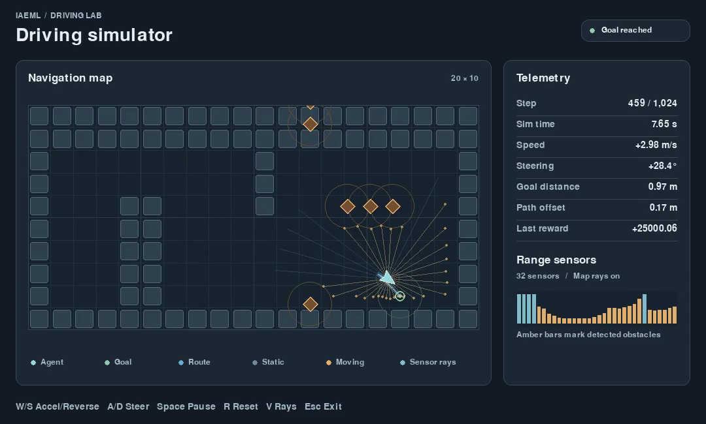

# IAEML Assignment · Robotaxi

A 2D driving simulator with continuous acceleration and steering. RobotaxiEnv
extends BaseEnv with bicycle dynamics, braking and reverse motion, rolling
resistance, aerodynamic drag, and a shared tyre friction limit.



## Run the simulator

Use Python 3.11. From the project root:

```bash
python -m pip install -r requirements.txt
python src/main.py --map-id 1 --no-record
```

On macOS, set `JAX_PLATFORM_NAME=cpu` before the command if needed. Interactive
play runs at 60 simulation steps per second with unlimited episode time by
default. Use `--max-steps` to set a limit. Leaving out `--no-record` records
to `artifacts/simulator/<timestamp>/episode.mp4`.

| Key | Action |
| --- | --- |
| W / Up | Accelerate |
| S / Down | Brake, then reverse while held |
| A / Left and D / Right | Steer |
| Space | Pause or resume |
| R | Reset the episode |
| V | Toggle sensor rays |
| Esc | Exit |

## Run the trained policy

```bash
python src/main.py --mode eval --map-id 1 --no-record
PYTHONPATH=src python -m algorithms.evaluate --video artifacts/evaluation.mp4
```

The included PPO checkpoint reached the goal on map 1 in **459 steps
(7.65 simulation seconds)** with no collision. The single-episode evaluation
command exits when the episode ends and prints its outcome as JSON.

## Reproduce training

```bash
PYTHONPATH=src python -m algorithms.pretrain
python src/main.py --mode train --map-id 1 \
  --init-checkpoint models/robotaxi_pretrained.msgpack \
  --total-timesteps 8192 --num-envs 8 --rollout-steps 128 \
  --episode-horizon 1024 --learning-rate 0.000003
```

Pretraining uses a reference controller and labels from states the actor
visits during its rollout. PPO starts from the resulting checkpoint. Each
run writes a new checkpoint, its metadata, metrics, and configuration into
a timestamped directory. To evaluate a checkpoint from a new run, pass its
path with `--checkpoint`.

## Report and evidence

- [Stage 1 report](report_stage_1.md)
- [Model equations and parameters](docs/stage_1_model.md)
- [Successful PPO run](docs/robotaxi-policy-run.mp4)
- [Verification results](docs/verification.md)
- [Experiment reflection](reflection.txt)
